<p align="center">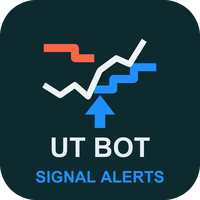</p>

# UT Bot Signal Alerts (MetaTrader 5 and MetaTrader 4)

A free ATR trailing-stop indicator that draws one stop line and one buy or sell arrow per signal, **on closed bars only**,
and sends an alert for each arrow. Source for both editions, a Python reference of the maths, and the tests that were used
to check that the MT5 and MT4 code, the Python reference and each other all agree.

**Website:** [allanninal.dev/mql5 (indicators)](https://www.allanninal.dev/mql5/#indicators) · [MT4 editions](https://www.allanninal.dev/mql5/#mt4) · [allanninal.dev](https://www.allanninal.dev)
· **Contact:** message me on [LinkedIn](https://www.linkedin.com/in/allanninal/).

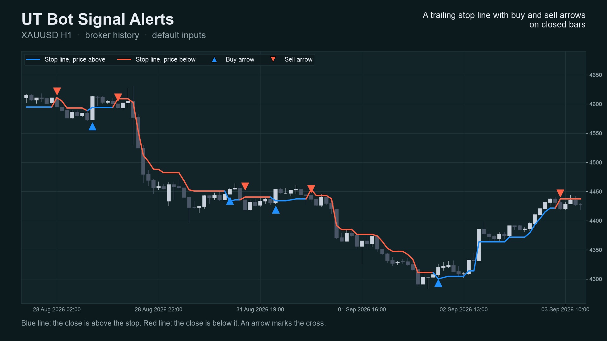

> It is an indicator, not a strategy. It draws a line and arrows and places no trades. Nothing here is a profit claim
> (see [Honest limits](#honest-limits)).

## Get it on the MQL5 Market

| Edition | Platform | Price | Link |
|---|---|---|---|
| UT Bot Signal Alerts | MT5 | free | <https://www.mql5.com/en/market/product/201607> |
| UT Bot Signal Alerts MT4 | MT4 | free | <https://www.mql5.com/en/market/product/202304> |
| UT Bot Scanner | MT5 | paid | <https://www.mql5.com/en/market/product/201600> |
| UT Bot Scanner Pro MT4 | MT4 | paid | <https://www.mql5.com/en/market/product/202391> |

The Market builds are the same calculation as the source in this repository. The two scanner editions are a separate,
paid product that is **not** part of this repository (see [Free vs Pro](#free-vs-pro)).

## Contents

1. [What it is and who it is for](#what-it-is-and-who-it-is-for)
2. [Why it was built](#why-it-was-built)
3. [How it works](#how-it-works)
4. [Non-repainting: the proof and how it was tested](#non-repainting-the-proof-and-how-it-was-tested)
5. [Architecture and buffers](#architecture-and-buffers)
6. [Inputs, alerts, install and compile](#inputs-alerts-install-and-compile)
7. [Run the Python reference and the tests](#run-the-python-reference-and-the-tests)
8. [Honest limits](#honest-limits)
9. [Free vs Pro](#free-vs-pro)
10. [Licence and credits](#licence-and-credits)

## What it is and who it is for

**What:** the "UT Bot" method as a native MetaTrader indicator. A trailing stop sits `key value x ATR` away from price. It
only ratchets with the trend. When the close crosses the line, you get an arrow (buy above, sell below) and an alert
(pop-up, sound, push, e-mail). Two optional filters: a Heikin Ashi close as the source, and an EMA trend filter.

**For:** traders who want a clean, readable trend-flip marker on any symbol and timeframe, and who want to know the arrow
they saw will still be there tomorrow. Also for developers who want a small, tested indicator with documented buffers to
read from an EA with `iCustom`.

**Not for:** anyone who expects arrows to predict direction. They mark where the close crossed a volatility-scaled stop.

| | |
|---|---|
| 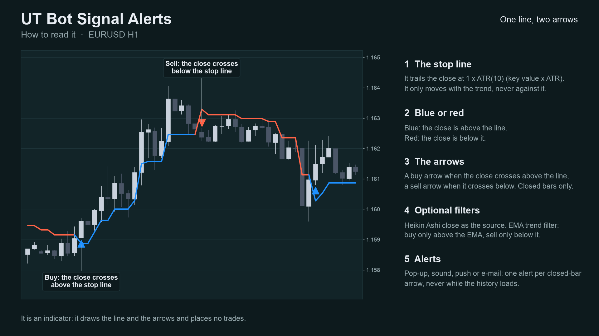 | 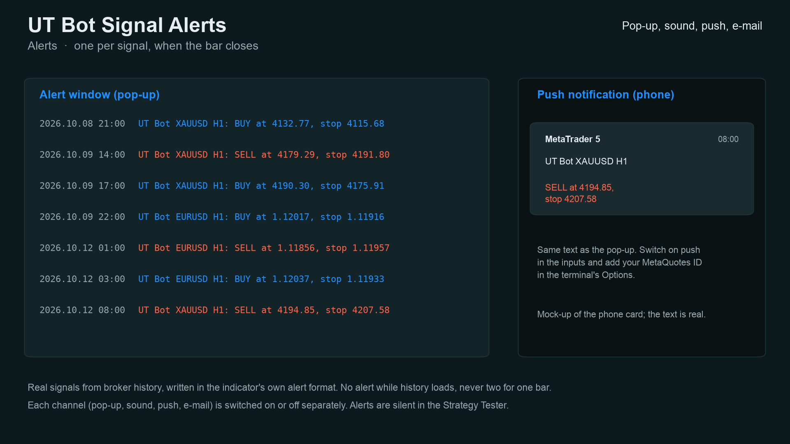 |
| 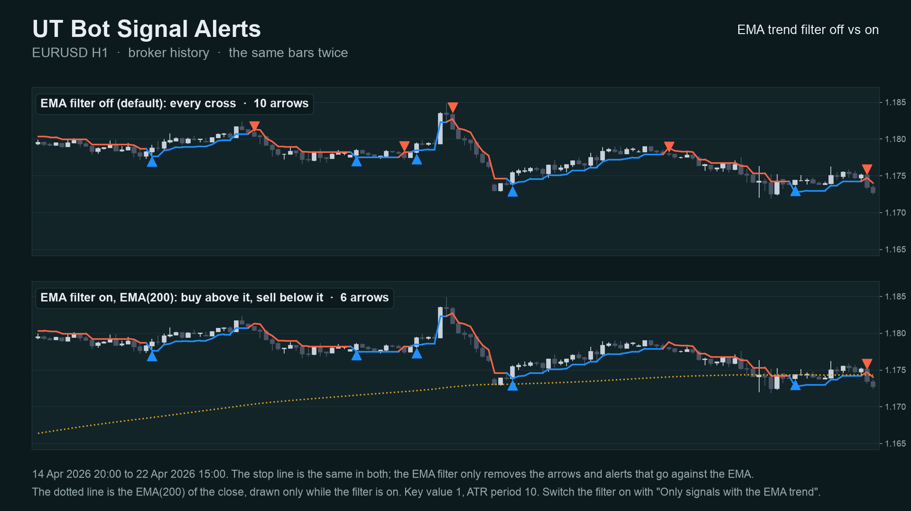 | 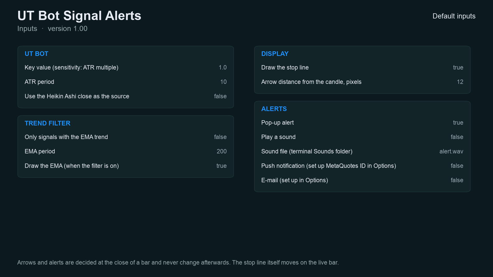 |

Image notes: charts 01-03 are drawn by the Python reference on broker history (the same numbers the indicator shows); the
alert text on 06 is the indicator's real text but the pop-up and phone card around it are mock-ups; the Data Window panel
on 08 is a mock-up of the buffer map. They are illustrations, not terminal captures. MT4 versions are in
[`docs/images/mt4/`](docs/images/mt4).

## Why it was built

The UT Bot is one of the most copied TradingView scripts, and traders who move to MetaTrader keep asking for it. The
motivations, stated with the evidence we actually have:

- **A native, readable port.** The method is simple (an ATR trailing stop) and does not need a closed-source box.
- **Trust in the arrows.** Our market research (demand scan of MQL5 Market, forums and freelance boards, October 2026)
  found repeated complaints about arrow indicators that repaint, and a 2026-07 request for "arrows confirmed on bar
  close". The design rule follows: an arrow is only drawn on a bar that has closed, and never moves afterwards.
- **Honest scale of demand.** The same research found that *named* classic indicators such as UT Bot are requested only
  rarely by name (1 to 14 requests per board). So this is a free tool that gives a clean reference implementation and
  builds a track record, not a claim of mass demand.
- **Provable behaviour.** Every number in this README comes from an executed check, listed below, not from a promise.

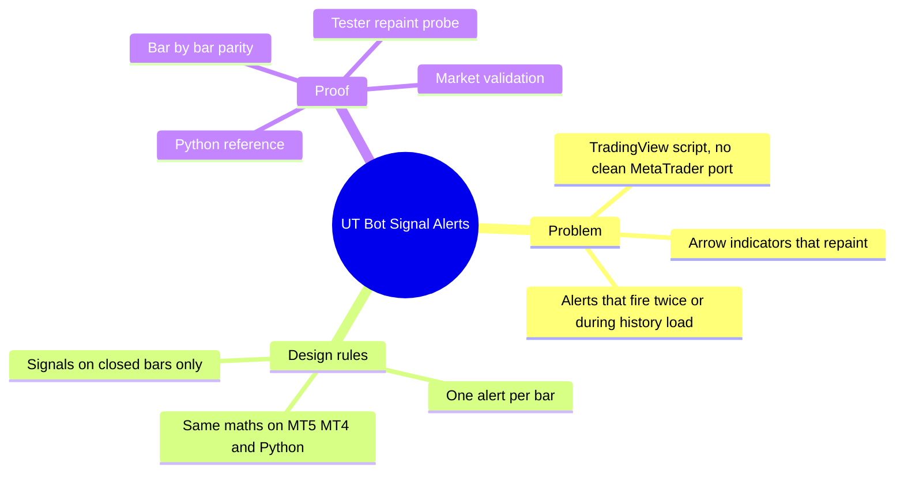

## How it works

### The maths, step by step

Let `O, H, L, C` be the bar's open, high, low, close, `i` the bar index (oldest = 0), `n` the ATR period and `k` the key value.

1. **True range**

   `TR[i] = max(H[i]-L[i], |H[i]-C[i-1]|, |L[i]-C[i-1]|)`, and `TR[0] = H[0]-L[0]`.

2. **ATR (Wilder's smoothing, seeded with a simple average, as on TradingView)**

   `ATR[n-1] = mean(TR[0..n-1])`, then `ATR[i] = (ATR[i-1] * (n-1) + TR[i]) / n`.

3. **Source** `src[i]`: the close `C[i]`, or with Heikin Ashi on `(O+H+L+C)/4`.

4. **Loss distance** `nLoss[i] = k * ATR[i]`.

5. **Trailing stop** `T[i]`, with `T[-1] = 0`:

   - price above the stop on this and the previous bar: `T[i] = max(T[i-1], src[i] - nLoss[i])` (the stop only rises)
   - price below the stop on this and the previous bar: `T[i] = min(T[i-1], src[i] + nLoss[i])` (the stop only falls)
   - otherwise (the first bar after a flip): `T[i] = src[i] - nLoss[i]` if `src[i] > T[i-1]`, else `src[i] + nLoss[i]`

6. **Signals** (on closed bars only):

   - Buy: `src[i] > T[i]` and `src[i-1] <= T[i-1]`
   - Sell: `src[i] < T[i]` and `src[i-1] >= T[i-1]`
   - With the EMA filter: a buy also needs `C[i] > EMA[i]`, a sell `C[i] < EMA[i]`, where `EMA` is seeded with the
     average of the first `p` closes and then `EMA[i] = EMA[i-1] + 2/(p+1) * (C[i] - EMA[i-1])`.

The stop line is blue while the source is above it and red while below. The live bar's line may move; arrows are never
drawn on it.

### Per-bar algorithm

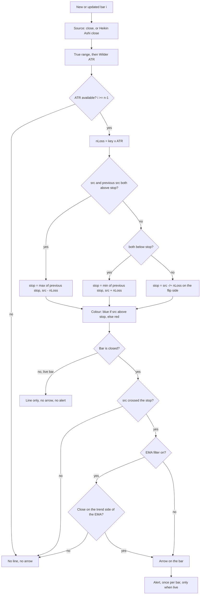

### Signal states

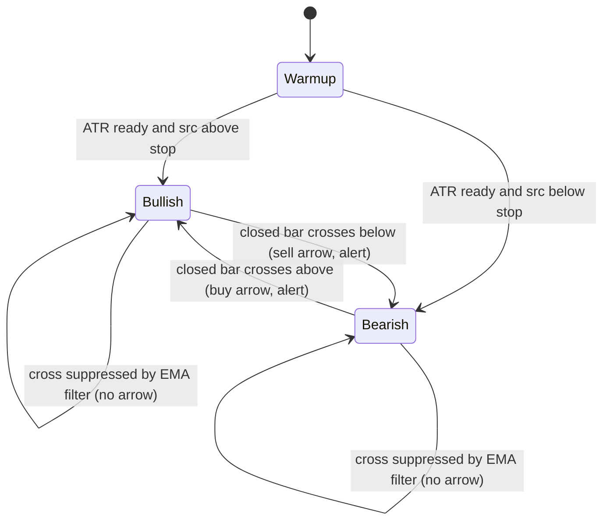

### Alert flow

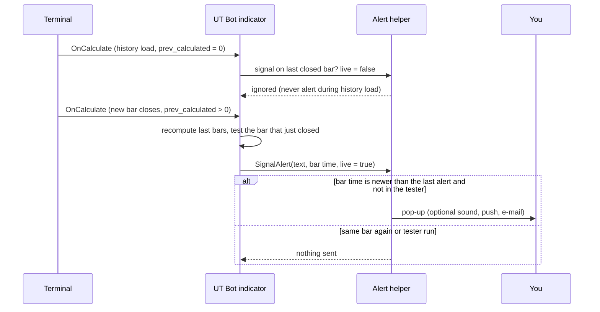

### What the key value does (measured)

More sensitivity, more arrows. Arrows (buy plus sell) per month on closed bars of broker history, 2023-10-02 to
2026-10-12, ATR period 10, other inputs default. Source: [`docs/data/arrows-per-month.json`](docs/data/arrows-per-month.json).
This counts arrows only. It says nothing about profit.

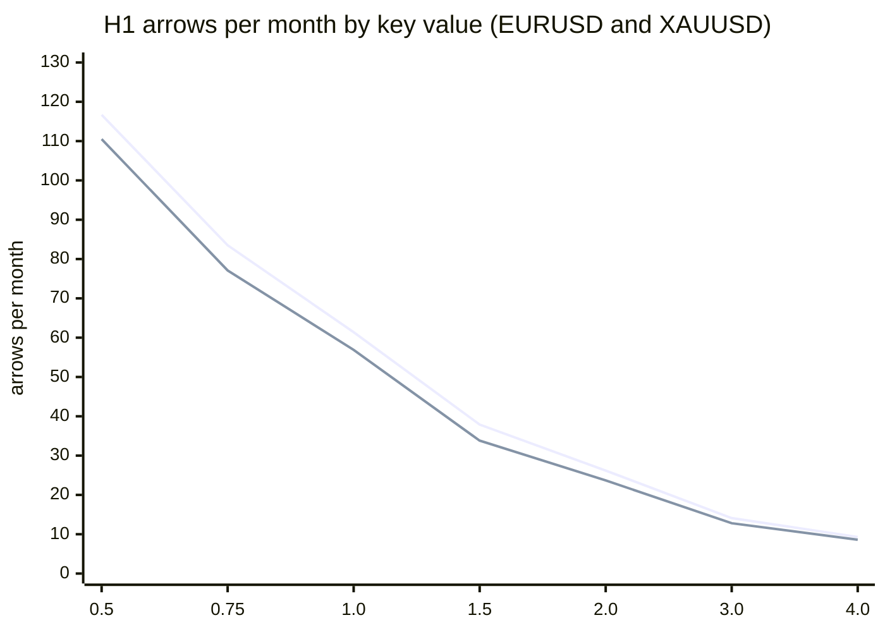

First line EURUSD, second XAUUSD.

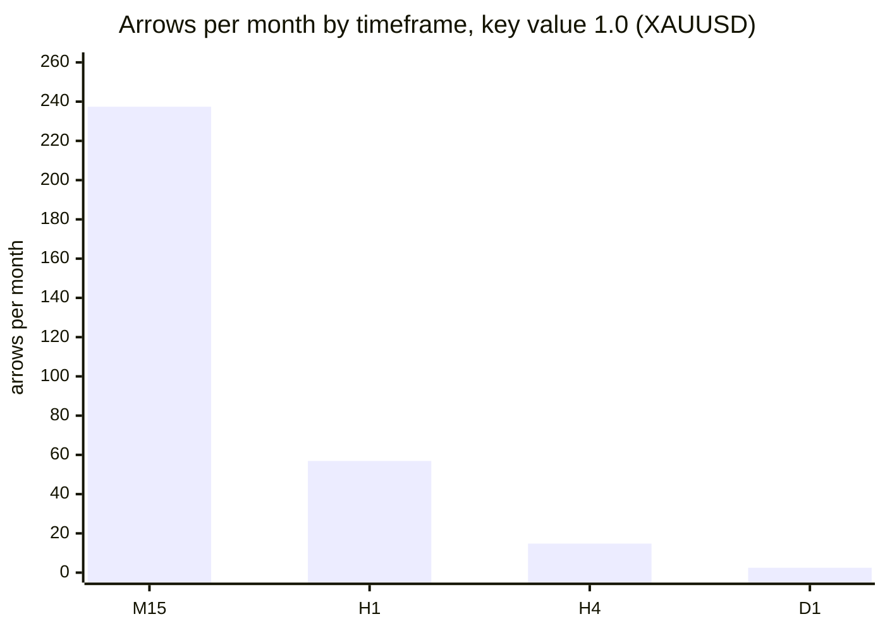

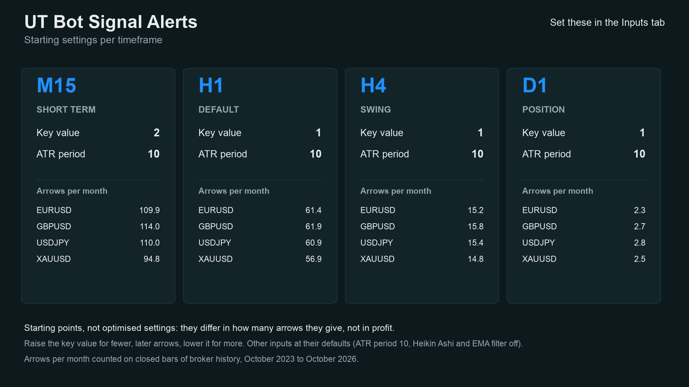

## Non-repainting: the proof and how it was tested

"Non-repainting" is easy to claim. Here is what was actually run. Raw result files are in [`tests/results/`](tests/results).

**1. Three implementations, compared bar by bar.** The Python reference
([`tests/reference.py`](tests/reference.py)) was written from the TradingView script's behaviour, not translated from the
MQL code. The MT5 and MT4 indicators were then dumped bar by bar (stop line, buy, sell buffers) in the MetaTrader
Strategy Tester, and [`tests/check_parity.py`](tests/check_parity.py) compared each dump with the reference. Pass means:
every closed bar's line within 1e-9 relative, and arrows on exactly the same bars.

| | MT5 | MT4 |
|---|---|---|
| dumps compared | 36 (4 symbols x M15/H1/H4 x 3 input sets) | 37 (same 36 + one every-tick EURUSD H1) |
| bars compared | 978,390 | 761,453 |
| arrows compared (buy + sell) | 78,321 | 61,457 |
| result | ALL PASS | ALL PASS |

Symbols: EURUSD, XAUUSD, GBPJPY, BTCUSD. Input sets: defaults; key 2.0 / ATR 14 / EMA filter on; Heikin Ashi on.
Source: [`tests/results/parity-mt5-and-mt4.txt`](tests/results/parity-mt5-and-mt4.txt). MT5 history starts in 2024 and the MT4 test history is shorter on the FX pairs, which is why the bar counts
differ.

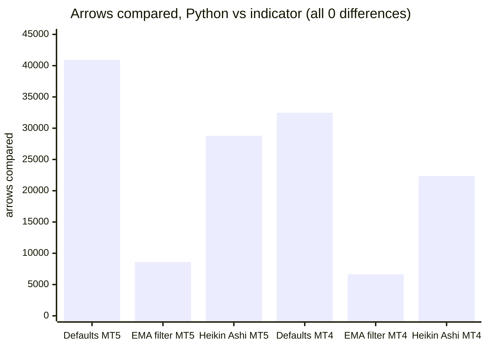

(MT4 "Defaults" is 31,756 arrows over 12 runs plus 714 in the every-tick run = 32,470.)

**2. Repaint probe.** An EA records which signal buffers are set on each bar *at the moment it closes*, then reads the same
bars again at the end and counts any value that changed. It also counts any signal ever shown on the still-forming bar.

| Run | Closed bars checked | Signals seen at close | Changed afterwards | Signals on the live bar |
|---|---|---|---|---|
| MT5, EURUSD H1, every tick, 10,411,052 ticks | 4,644 | 559 | **0** | **0** |
| MT4, 37 runs combined | 756,852 | 61,150 | **0** | **0** |

Source: [`tests/results/repaint-summary.md`](tests/results/repaint-summary.md). The MT5 repaint probe was run once (EURUSD H1,
default inputs); the MT4 probe ran on every dump run.

**3. Market validation.** Both Market builds passed the MQL5 Market's automated product validation before publication
(this is the Market's own check, not part of this repository).

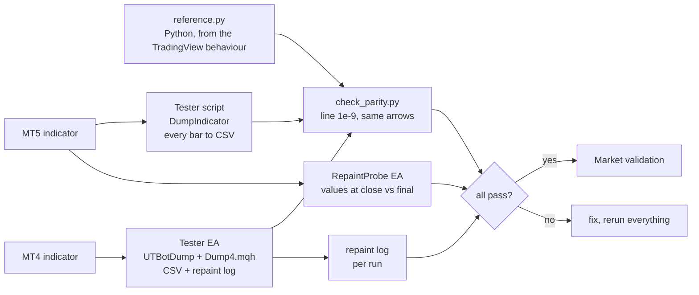

### Why the design cannot repaint

- Arrows are written only when `i <= rates_total - 2`, i.e. never on the forming bar.
- Each bar's stop depends only on that bar and earlier bars (a recursive formula, no look-ahead).
- Alerts fire only for the bar that just closed, only after the history load, once per bar, and never in the tester.
- What *does* move: the stop line on the forming bar, because the live close changes. That is shown in the "live bar" line
  above and is not a signal.

## Architecture and buffers

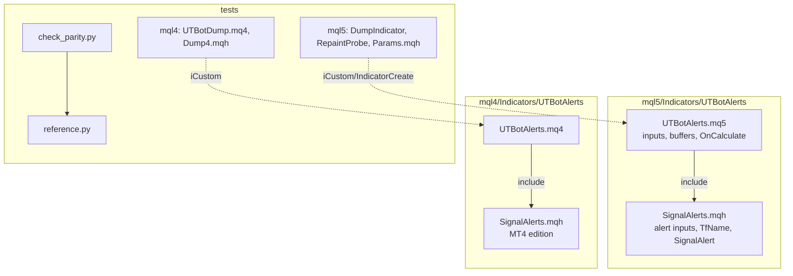

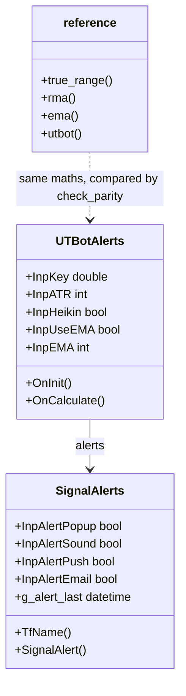

### `iCustom` buffer table (for EA developers)

| Buffer | MT5 | MT4 |
|---|---|---|
| 0 | stop line (colour line) | stop line (not drawn; read this one) |
| 1 | colour index of the line (0 blue, 1 red) | blue half of the drawn line |
| 2 | **Buy** arrow price (bar low), empty otherwise | **Buy** arrow price, empty otherwise |
| 3 | **Sell** arrow price (bar high), empty otherwise | **Sell** arrow price, empty otherwise |
| 4 | trend EMA (when the filter is on) | red half of the drawn line |
| 5 | calculation buffer | trend EMA (when the filter is on) |
| 6-8 (MT5) / 6-9 (MT4) | calculation buffers (ATR, source, Heikin Ashi open, EMA) | calculation buffers |

Empty value is `EMPTY_VALUE`. Read arrows on **closed bars** (shift 1 and higher). `iCustom` parameters follow the input
order: key, ATR period, Heikin Ashi, EMA filter, EMA period, show EMA, show line, arrow gap, pop-up, sound, sound file,
push, e-mail. In MT5 the `input group` headings also count as string parameters when you build a handle with
`IndicatorCreate` (see `tests/mql5/Include/IndTest/Params.mqh`).

## Inputs, alerts, install and compile

| Input | Default | Meaning |
|---|---|---|
| Key value | 1.0 | ATR multiple. Higher: fewer, later arrows. Lower: more arrows |
| ATR period | 10 | Wilder ATR length |
| Use the Heikin Ashi close as the source | false | Source is `(O+H+L+C)/4` |
| Only signals with the EMA trend | false | Buy only above, sell only below the EMA |
| EMA period | 200 | Length of the trend EMA |
| Draw the EMA | true | Show the EMA when the filter is on |
| Draw the stop line | true | Show or hide the line (arrows stay) |
| Arrow distance from the candle | 12 px (MT5) / 0.3 x ATR (MT4) | Gap between arrow and candle |
| Pop-up alert | true | Terminal alert window |
| Play a sound / sound file | false / alert.wav | File from the terminal's Sounds folder |
| Push notification | false | Needs your MetaQuotes ID in Options |
| E-mail | false | Needs e-mail set up in Options |

**Install from source.** Copy `mql5/Indicators/UTBotAlerts/` into `<terminal data folder>/MQL5/Indicators/` (MT5) or
`mql4/Indicators/UTBotAlerts/` into `<data folder>/MQL4/Indicators/` (MT4), open `UTBotAlerts.mq5` or `.mq4` in MetaEditor
and press Compile (F7). Both compile with 0 errors and 0 warnings (checked on a Windows machine with MetaEditor; the
compiled files are not in the repository). Keep the two files of each edition together: the indicator includes
`SignalAlerts.mqh` from its own folder.

## Run the Python reference and the tests

```bash
python3 -m venv .venv && . .venv/bin/activate && pip install -r requirements.txt
```

```python
import sys; sys.path.insert(0, "tests")
import numpy as np
from reference import utbot
# o, h, l, c are float arrays of OHLC bars, oldest first
trail, buy, sell = utbot(o, h, l, c, key=1.0, atr_period=10)   # buy/sell hold the arrow price or NaN
```

To repeat the parity check on your own data:

1. Compile the indicator and the test tool for your platform (`tests/mql5/Scripts/DumpIndicator`, or `tests/mql4/UTBotDump.mq4`
   with `tests/mql4/Include/IndTest4/Dump4.mqh` in your `MQL4/Include/IndTest4/`; MT5 also needs `tests/mql5/Include/IndTest/Params.mqh`).
2. Run it in the Strategy Tester (MT4) or as a script (MT5) for each symbol and timeframe, with the input sets in
   `tests/configs.tsv` (MT5) / `tests/mql4/configs.tsv` (MT4). The tool writes one CSV per symbol and timeframe.
3. `python3 tests/check_parity.py <folder with the CSVs>` (MT4 dumps use text times; the script reads the MT5 format, so
   convert them or adapt `check()` for MT4 CSVs). It prints PASS or FAIL per file and an overall result.
4. Repaint: run `tests/mql5/Experts/RepaintProbe` in the MT5 Strategy Tester (every tick); MT4 writes its repaint log with the dump.

The price dumps used for the published numbers are not in this repository (they are broker price data).

## Honest limits

- **An indicator signal is not a strategy.** No stop-loss, position sizing or exit rules are provided or implied, and the
  arrows were not optimised or back-tested for profit. Whether a trend flip makes money depends on your market, costs and rules.
- **No profit or accuracy claim is made.** The only numbers here are about *consistency* (the three implementations agree,
  signals do not move) and *frequency* (arrows per month).
- **Lag is built in.** A trailing stop confirms a move after it started; fewer arrows (higher key value) come later still.
- **Sideways markets** produce frequent flips; the EMA filter reduces some of them but not all.
- **Data-dependent.** ATR is seeded from the first bars in the terminal's history, so the very first arrows of a short
  history can differ from a longer one.
- **Scope of the tests.** Four symbols, three timeframes, three input sets, one MT5 repaint run. Other symbols and
  timeframes are not covered by the published numbers. The MT5 build was not run on a live chart as part of these numbers.
- A multi-symbol scanner that watches these signals across many symbols exists as a separate paid product (see below).

## Free vs Pro

| | Free: UT Bot Signal Alerts | Paid: UT Bot Scanner |
|---|---|---|
| Platforms | MT5 [201607](https://www.mql5.com/en/market/product/201607), MT4 [202304](https://www.mql5.com/en/market/product/202304) | MT5 [201600](https://www.mql5.com/en/market/product/201600), MT4 (Pro) [202391](https://www.mql5.com/en/market/product/202391) |
| Price | free | paid (see the Market page) |
| What you get | UT Bot line and arrows on the current chart, alerts, source here | A multi-symbol, multi-timeframe scanner of UT Bot signals, as described on its Market listing |
| Source | this repository | not published |
| Closed-bar signals, no repaint | yes | see its listing |
| Heikin Ashi source, EMA filter | yes | see its listing |

No need to buy the paid product to use the free one: the free indicator is complete on its own.
Website: [allanninal.dev/mql5](https://www.allanninal.dev/mql5/#indicators) ([MT4](https://www.allanninal.dev/mql5/#mt4)).

## Licence and credits

**Origin of the maths.** The UT Bot idea, an ATR trailing stop on the close, is by **Yo_adriiiiaan** ("UT Bot Strategy" on
TradingView), from an original idea by **HPotter**. The TradingView script **"UT Bot Alerts"** (published 8 February 2020)
is by **QuantNomad**; it is open source on TradingView. Thank you to all three.

**What this means for the licence.** TradingView publishes open-source scripts under the Mozilla Public License 2.0 unless
the author states another licence. I could not retrieve the original script's header to confirm that it states MPL-2.0, so
I took the conservative route: the three files that implement the UT Bot calculation are licensed **MPL-2.0**:

- `mql5/Indicators/UTBotAlerts/UTBotAlerts.mq5`
- `mql4/Indicators/UTBotAlerts/UTBotAlerts.mq4`
- `tests/reference.py`

They are independent implementations in other languages (the Python one written from the script's described behaviour,
not translated), plus additions (closed-bar signals, alerts, EMA filter), but treating them as derived from an MPL-2.0
work is the safe reading. MPL-2.0 is file-level: changes to those files must stay MPL-2.0 and be shared.

Everything else (alert helper `SignalAlerts.mqh`, test tools, parity checker, docs, images) is © 2026 Allan Niñal under the
[PolyForm Noncommercial License 1.0.0](LICENSES/PolyForm-Noncommercial-1.0.0.md): free for personal and other
noncommercial use, not for commercial use. Each source file has an `SPDX-License-Identifier` line. Texts:
[`LICENSE`](LICENSE), [`LICENSES/MPL-2.0.txt`](LICENSES/MPL-2.0.txt). The licence applies to this source, not to anything
you build or trade with the indicator. Trading involves risk; the software is provided as is.

---

**Website:** [allanninal.dev/mql5](https://www.allanninal.dev/mql5/#indicators) · [MT4](https://www.allanninal.dev/mql5/#mt4) · [allanninal.dev](https://www.allanninal.dev)
· Questions: message me on [LinkedIn](https://www.linkedin.com/in/allanninal/).
